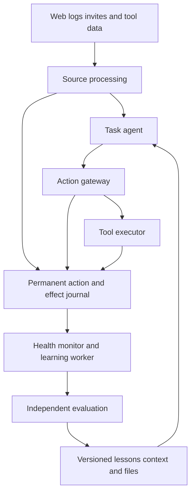
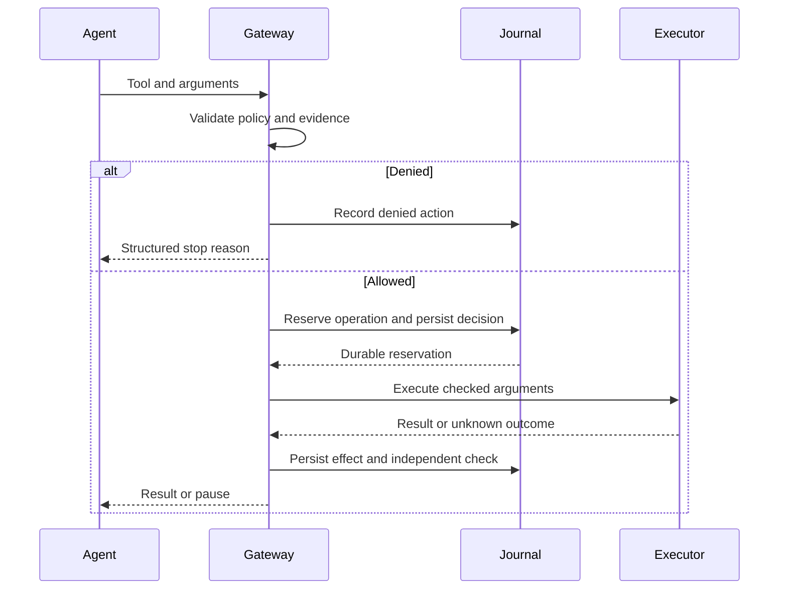
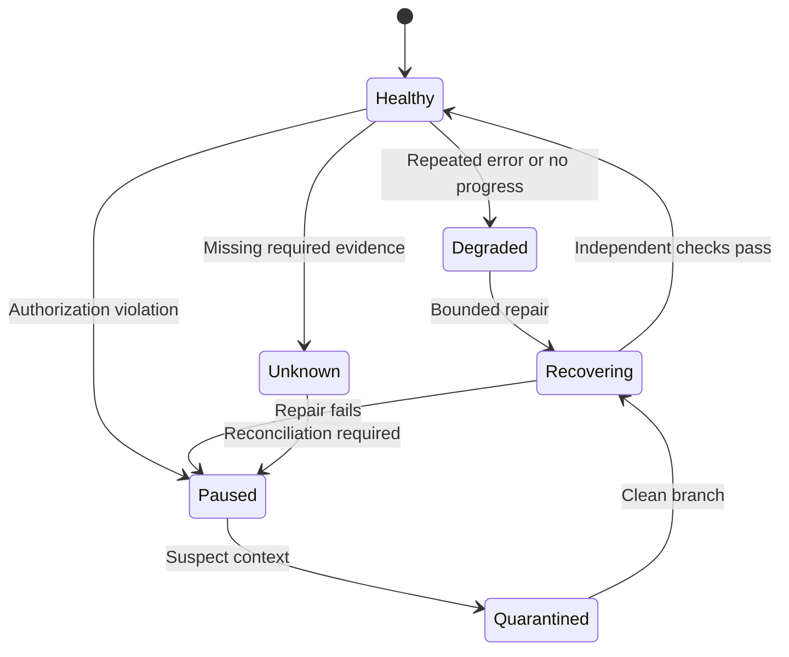
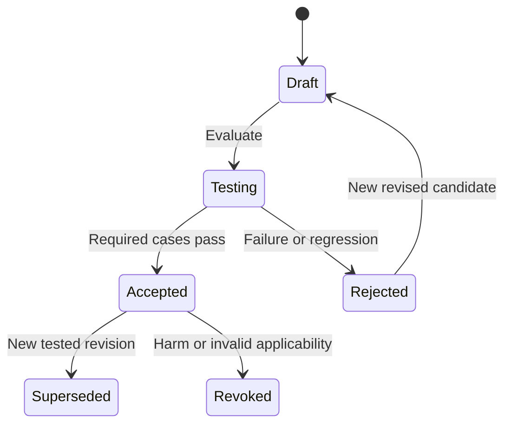
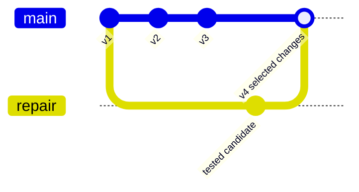
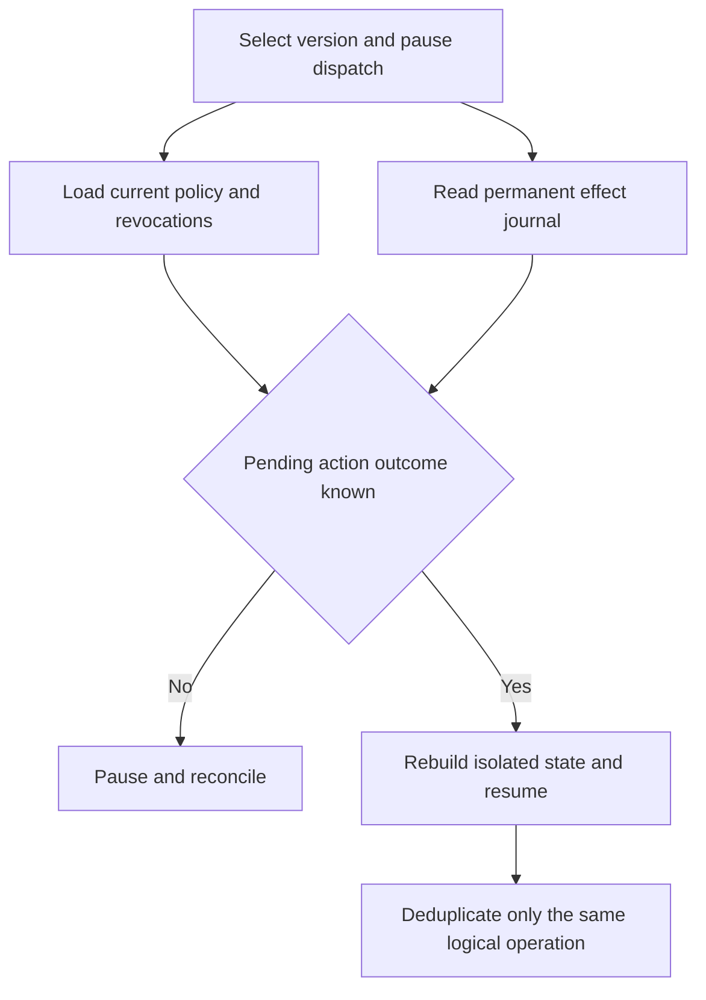

# ANTIBODY Technical Design

Implementation specification and agent handoff  |  Version 2  |  October 17 2026

## Build this system

Implement a protected agent workspace with durable runs, source-aware action checks, health monitoring, evaluated learning, shared project knowledge, and Git-like state management. RECEIPT is the version subsystem inside ANTIBODY. The companion Product Overview explains user value; this document defines behavior and implementation contracts.

## Instructions for an implementation agent

1. Treat requirements R01 through R13 and the invariants below as acceptance criteria. Implement the phases in order, preserving working vertical flows.
2. Use the chosen architecture unless repository constraints require an equivalent. Record a material deviation in an architecture decision note and update affected tests.
3. Provide real source ingestion, gateway enforcement, durable state, branch isolation, evaluation, and later-run use of accepted knowledge. Mark any sample or replay data.
4. Use existing libraries and documented patterns. Pin compatible dependency versions when implementing; this document does not prescribe unverified current version numbers.
5. Expose capability limits per runtime. A tool-only proxy must not claim full third-party agent checkpoint or restore.
6. Keep the technical Markdown and implemented API schemas aligned. Do not call a feature complete because its UI exists.

## Security and state invariants

All protected tools dispatch through the gateway. Outside content cannot grant authority. A learner cannot edit its checker or hard permissions. Denied actions never execute. Completed external effects survive restore. Accepted versions are immutable. Branches never share mutable files. Revoked knowledge cannot silently reappear from an old snapshot.

## Target deployment

First deliver a complete local developer application with a reference agent and compatible tool proxy. The wider design supports several agents and connected content sources. Build order follows feature dependencies; it does not impose a fixed demo time limit. No implementation or benchmark result is claimed by this specification.

# Requirements and completion evidence

| ID | Required capability | Completion evidence |
| --- | --- | --- |
| R01 | Assignment and typed permissions | A source cannot expand tools, roots, recipients, or spending scope |
| R02 | Source processing for web text, documents, logs, invites, and tool results | Actual parsers produce labeled source records and chunk offsets |
| R03 | Checks before tool execution | Denied executor count is zero and allowed arguments match checked arguments |
| R04 | Health monitoring and bounded recovery | Errors, stalls, budgets, and checks trigger specified states |
| R05 | Evaluated learning and revision | A saved candidate improves a fresh task and can later be revised |
| R06 | Shared project lessons and patterns | A separate agent loads a revision and uses compatible knowledge |
| R07 | Durable save and resume | A service restart reconstructs supported usable state |
| R08 | Fork diff and selected merge | Separate mutable branches and tested conflict handling |
| R09 | External effect reconciliation | Restore and retry do not duplicate the same logical operation |
| R10 | Context budget control | Compiled context respects a cap and preserves authority and sources |
| R11 | Usable evidence interface | A user follows incident to candidate to tests to accepted version |
| R12 | Runtime and tool integration | Reference agent and proxy expose tested capability profiles |
| R13 | Export and repeatable evaluation | Run manifests, results, and honest live or replay labels export |

## Full product versus extension

R01 through R13 belong to the planned product. Native account connectors, unrestricted computer control, hardened arbitrary shell execution, public threat federation, and model-weight training require additional integration or infrastructure. Implement those extensions explicitly when selected; the base product must not imply they already exist.

## Definition of a protected agent

An agent is protected only for actions and observations routed through a tested adapter. Display missing interception or checkpoint capabilities. The existence of a log file alone is not an enforcement integration.

# Architecture and ownership



The assignment service owns authorization. The gateway owns dispatch. The executor owns tool credentials. The journal owns observed decisions and effects. The evaluator owns immutable checks. The version service owns branch heads and manifests. The learner can propose records and request tests; it cannot grant permissions or certify its own result.

## Process layout

Run a FastAPI API service, a bounded worker pool, and a React client. Use SQLite in WAL mode for a complete local application. Store large content and file snapshots in a project-scoped content-addressed directory. Start with one durable job coordinator; use a repository boundary so PostgreSQL and remote object storage can replace local storage later.

## Two data paths

Inbound content passes source processing before entering agent context. Outbound actions pass the gateway before reaching a tool. Both produce journal events. This allows a fixed action boundary on a first encounter and learned early interception on a later encounter.

## Trust is not a model opinion

The service assigns trust and actor roles. A model-generated JSON field claiming system authority is data. Preserve this rule across summaries, imported memory, subagent messages, and restored state.

# Runtime and tool adapters

## Reference agent

Use LangGraph for the reference workflow and a persistent SQLite checkpointer, not an in-memory saver. Graph stages prepare context, request a structured action, call the gateway, verify the result, and continue or stop. The framework checkpoint supports execution continuity; RECEIPT separately pins lessons, artifacts, permission references, and version semantics. [S1]

Persist run_id, branch_id, thread_id, task_revision, context_packet_id, next_phase, action_id, and operation_id in serializable graph state. Re-entering a tool stage after replay must reconcile its operation ID before dispatch. LangGraph replay can re-execute downstream model and API calls; persistence alone does not provide effect deduplication. [S2]

## Tool proxy

Implement an MCP proxy for selected trusted tool servers. Pin server identity and tool schema hashes. Route tools/call through gateway policy, wrap results as observations, preserve protocol request correlation, and forward tool errors without elevating returned text. Negotiate supported protocol capabilities rather than assuming all servers behave identically.

A tool's own description or annotation cannot certify that it is safe or read-only. Store effect classification in an operator-controlled registry; MCP explicitly treats annotations as untrusted unless from trusted servers. [S3]

## Capabilities per adapter

```text
AdapterCapabilities:
  intercept_actions: bool
  label_observations: bool
  export_messages: bool
  restore_cursor: bool
  isolate_workspace: bool
  cancel_or_pause: bool
  export_context: bool
```

The reference agent supports the full profile. A proxy-only integration may intercept tools but lack the host agent's context or model cursor. In that case provide tool history and supported workspace versions, and disable unsupported full-agent restore. Never imply native Codex, Cursor, or Letta integration until its adapter has actually been built and tested.

## Subagents

Give each child its own run and context, with parent_run_id and handoff source references. Shared learning uses the registry. Parent and child must not inherit one another's mutable working memory by reference.

# Persistent records and database constraints

| Entity | Important fields | Constraint |
| --- | --- | --- |
| projects | id, policy_head, registry_head | Every lookup is scoped to a project |
| agents and runs | agent_id, run_id, branch_id, parent_run_id, adapter | Run references one immutable start configuration |
| tasks and grants | task_id, revision, permissions, grant_refs | Only trusted application actors create revisions |
| sources and chunks | source_id, content_hash, trust, raw_ref, offsets | Derived text retains original source references |
| events | event_id, run_id, sequence, kind, payload_ref | UNIQUE run_id and sequence |
| actions and decisions | action_id, args_hash, decision_id, policy_revision | Decision binds immutable checked arguments |
| effects | operation_id, decision_id, state, external_ref | UNIQUE project_id and operation_id |
| incidents and candidates | evidence_refs, diagnosis, candidate_revision, status | Observed facts and hypotheses are separate |
| lessons and registry | lesson_id, revision, scope, status, registry_revision | Accepted revisions immutable; revocation authoritative |
| versions and branches | version_id, manifest_hash, parents, branch_head | Head updates compare the expected old value |
| evaluations and jobs | suite_revision, checker_hash, results, lease | Worker completion uses a single atomic claim |

## Storage rules

Use foreign keys, explicit migrations, UTC timestamps, and schema_version on serialized payloads. Index project plus status, run plus sequence, source hash, and lesson applicability. Use a short database transaction for state transitions; never hold it while waiting for a model or remote tool.

## Evidence access

Store sensitive raw evidence separately from redacted UI summaries. A version can reference evidence without making its contents visible to every viewer. Local development still uses scoped service tokens and binds to loopback by default.

# Typed events actions and sources

## Common event envelope

```json
{
  "event_id": "evt_018",
  "project_id": "proj_demo",
  "run_id": "run_a",
  "sequence": 18,
  "timestamp_utc": "2026-10-17T08:20:00Z",
  "kind": "action.decided",
  "actor_type": "gateway",
  "payload_ref": "sha256:...",
  "evidence_refs": ["src_4:chunk_2"],
  "policy_revision": "policy_3",
  "registry_revision": 7,
  "schema_version": 1
}
```

## Proposed action

```text
ActionProposal = {
  action_id, run_id, tool_id, tool_schema_hash,
  arguments, operation_id, observation_refs
}
Decision = {
  decision_id, action_id, arguments_hash,
  outcome, reason_code, policy_revision,
  task_revision, expires_at, evidence_refs
}
```

The agent supplies a proposal. Run identity, actor identity, policy references, and permission bindings come from authenticated server state. A client cannot substitute them. Strict schemas reject extra authority fields. Store raw arguments securely and use a redacted view for display.

## Source trust

Use origin categories USER_ASSIGNMENT, OPERATOR_POLICY, EXTERNAL_DATA, AGENT_DERIVED, and VERIFIED_TOOL_METADATA. Derived summaries retain dependency IDs and cannot upgrade external content to user authority. A retrieved memory is not a new user request. Trusted metadata such as an executor exit code is distinct from untrusted stderr text.

## Core events

Implement observation.received, action.proposed, action.decided, effect.started, effect.completed, effect.unknown, check.finished, incident.opened, candidate.created, evaluation.finished, lesson.promoted, lesson.revoked, version.saved, and registry.loaded.

# Assignment and permission contract

## Compile explicit authority

The user supplies the goal and selects resources and actions in the application. An LLM may suggest a draft contract, but permissions become authoritative only through the trusted assignment service. Keep the natural-language goal alongside typed constraints. Changing either creates a new task revision.

```json
{
  "task_id": "task_report",
  "revision": 3,
  "goal": "Create a report and send it to Finance",
  "tools": ["read_source", "write_report", "send_report"],
  "file_roots": ["workspace://branch/current"],
  "recipient_ids": ["finance_team"],
  "outbound_data_classes": ["approved_report"],
  "read_network": {"public_https": true},
  "write_network": {"destination_ids": []},
  "spending": {"currency": "USD", "limit": "0.00"},
  "grant_refs": [],
  "max_tool_steps": 30
}
```

## Enforcement semantics

Resolve recipient IDs and destination IDs through server-owned records. External content may supply facts needed for the job, such as a report date, but cannot add a recipient, enlarge a file root, or change a spending limit. A task that genuinely authorizes payment or deletion can allow it under typed limits and any required grant.

## High impact grants

Bind a grant to the project, exact tool and canonical arguments or a narrowly defined operation class, resource scope, expiry, and remaining uses. Check it at dispatch and consume it atomically with the effect reservation. A prior chat approval must not be copied into a broader reusable model instruction.

## Ambiguous requests

If required authority is missing, pause the particular action and explain the missing scope. Continue independent authorized work if possible. A policy violation is not sufficient evidence to label its source an attack.

# Processing web logs and calendar content

## One observation format across channels

Every adapter creates a source record, raw content object, normalized view, chunks with offsets, origin metadata, retrieval time, and dependency references. Source checks run before that view enters model context. Preserve what was excluded so the incident inspector can explain the decision.

| Adapter | Actual ingestion | Important boundary |
| --- | --- | --- |
| Web and document | Fetch permitted public HTTPS or import HTML, text, or Markdown | Restrict redirects, private network access, size, and active content |
| Log file | Read permitted text or JSONL files with stable offsets | Treat message text and user-controlled values as external data |
| Calendar invite | Parse imported ICS and normalized event JSON | Descriptions, titles, attendees, locations, and links are data |
| Tool result | Wrap text, structured fields, and resource references | A remote result cannot alter the assignment |
| Subagent message | Attach parent and child run IDs and original sources | Parent receives evidence, not inherited authority |

## Parsing policy

Start with configurable limits of 512 KiB per source view and 2000 characters per chunk with 200 characters overlap. Preserve raw bytes under a separate cap. These are engineering defaults. Reject malformed encodings safely, limit decoding to declared supported formats, and never run scripts, macros, or recursively expanding payloads.

## HTML and calendar handling

Keep raw HTML for restricted evidence and produce a safe text view. Record suspicious hidden spans separately; do not render raw markup in the UI. Parse ICS with a maintained parser, including line folding and time zones. Do not open invite links or attachments automatically. An organizer name or an event in the user's calendar does not create authorization.

## File ingestion versus account access

Imported files are real supported inputs. A live Google or Microsoft calendar connector uses a separate authenticated adapter, selected calendars, and limited scopes. It still produces the same observation format. Live account connection is an integration deliverable, not implied by parsing an invite.

# Action execution sequence



## Bind before dispatch

The adapter, not the model, obtains action_id and operation_id from the coordinator. The model schema contains only tool selection and arguments. A retry of the same logical operation reuses its server-issued operation ID; a different intended operation receives a new one.

## Allowed calls

The gateway stores canonical arguments and their hash. A worker atomically claims a short-lived decision and operation reservation, rechecks current task and policy revisions, and dispatches the stored arguments. It does not accept a second argument payload from the agent or browser.

## Denied calls

Write the denied decision and reason before returning it. Do not call the executor. An attempt with the same operation ID but different arguments or ownership returns a conflict. Never reveal another run's effect result through a guessed ID.

## Uncertain calls

If an executor may have completed before a timeout or crash, mark the outcome Unknown. Stop dependent mutating actions until reconciliation establishes the result. A model's claim that nothing happened is not reconciliation.

# Policy and decision algorithm

## Ordered checks

```python
def decide(proposal, server_state):
    validate_actor_run_and_branch(proposal, server_state)
    validate_tool_schema_and_argument_limits(proposal)
    resolved = resolve_resources_with_trusted_registry(proposal)
    enforce_current_task_permissions(resolved)
    enforce_revocations_and_hard_policy(resolved)
    enforce_budgets_and_operation_identity(resolved)
    evidence = collect_action_support(resolved)
    if requires_semantic_audit(resolved, evidence):
        audit = constrained_auditor(resolved, evidence)
        if audit.uncertain:
            return PAUSE
        if audit.unsupported_or_hostile:
            return DENY
    return persist_bound_decision(ALLOW, resolved)
```

This is required behavior expressed as pseudocode. Implement error handling so failed checks persist a structured decision. Policy errors, unavailable storage, malformed auditor output, and timeouts fail closed for mutating actions. Read-only continuation may proceed only under an explicit safe fallback policy.

## Deterministic restrictions

Check tool identity, canonical file scope, destination ID, data class, spending limits, grant use, method, and size. The executor repeats relevant resource checks at use time. Use a contained file executor with resolved roots and symlink restrictions; simple string-prefix checks are insufficient.

## Semantic auditing

Audit high-impact actions and actions whose supporting evidence is untrusted or contradictory. Supply the assignment, canonical action, minimal source spans, and fixed rules to a separate constrained model. Require outcome, reason_code, evidence_refs, and uncertainty. Its natural-language output cannot grant missing permissions.

## Decisions

Use ALLOW, DENY, and PAUSE for action decisions. QUARANTINE is a source or memory disposition, accompanied by a paused action or a clean retry. Stable reason codes include TOOL_NOT_ALLOWED, SCOPE_VIOLATION, DESTINATION_NOT_AUTHORIZED, UNSUPPORTED_ACTION, KNOWN_PATTERN, BUDGET_EXCEEDED, STALE_REVISION, and OUTCOME_UNKNOWN.

# Attribution and clean context repair

## Record evidence without inventing certainty

Create explicit edges from an observation to the model call that received it, from that call to the action it produced, and from the action to its result. Also record argument anchors such as a destination appearing in a particular source chunk. These edges show exposure and linkage; they do not alone prove causation.

## Attribution levels

| Level | Meaning | Permitted presentation |
| --- | --- | --- |
| Observed | The record directly shows an error, source, argument, or result | Show as fact with an event reference |
| Hypothesized | A model or heuristic proposes an explanation | Label as suspected cause |
| Intervention supported | A controlled changed-input branch changes behavior in repeated checks | Show test setup and remaining uncertainty |
| Verified outcome | An independent checker confirms the intended result or a blocked executor | Claim only the checked outcome |

## Optional controlled attribution

Fork the pre-observation state, keep the assignment and fixed settings, mask candidate spans, and rerun a bounded number of model steps. Disable side-effecting tools or replace them with recorded read-only results. Compare the action and its arguments, including repeated-payload variants. Persist both trajectories. Use this to strengthen a source hypothesis, not to claim universal causal certainty.

## Repair the history

Once content is quarantined, rebuild from a checkpoint before exposure or compile a clean packet from trusted task state and independently validated progress. Remove or replace derived summaries and memories that depended on the quarantined content. Appending an Ignore that instruction message to a contaminated history is not the complete repair.

## Research relationship

ActGuard informs action and argument auditing; ARGUS informs source support and task invariants. The initial implementation uses typed provenance and a constrained auditor. It does not reproduce their complete attribution methods or inherit their reported security results. [S4 S5]

# Health signals and state transitions



## Observable signal rules

Execution errors use trusted wrapper codes and failed checks. A repeated operation fingerprint includes tool class, normalized error family, relevant environment version, and task phase. Ignore incidental filenames only when that normalization cannot merge materially different operations.

Progress uses explicit completed steps, artifact changes, and task checks. Start with configurable triggers of two equivalent failures, three steps without measurable progress, 30 tool actions, or a run budget cap. These are initial engineering defaults. Expose and record them; tune using evaluations.

## Context and memory health

Track compiled token count against the configured model limit and flag missing or estimated usage. Trigger a rebuild near the configured context allowance. Detect conflicting or expired lessons through typed conditions and verification. A language-model contradiction report opens a candidate incident rather than silently deleting memory.

## Recovery behavior

A recovery creates an isolated branch, has a separate step and cost budget, and passes the same gateway. Exhausting that budget pauses the run. A failed repair does not justify escalating file access or tool permissions. Record the reason for every state transition.

# Candidate lifecycle and learning authority



## Candidate kinds

Support ProcedureLesson, ThreatPattern, MemoryFactRevision, and ContextRepair. Later support HarnessPatch through a contained code-change workflow. A candidate contains a diagnosis, source evidence, applicability, expected impact, negative cases, a proposed change, and requested evaluation. None of these fields certifies success.

## Independent evaluation

The evaluator loads a fixed suite revision and checker hash from a separate registry. Candidate authors cannot edit these through the application. Return case IDs, observable results, sanitized feedback, and measured cost. Keep hidden expected outputs outside the learner's context.

## Acceptance modes

Support manual acceptance after passing checks and automatic acceptance for an owner-enabled class of low-risk changes. Automatic acceptance still requires the fixed checks, compatible scope, current parent head, and no protected regression. A candidate that needs a human click must be labeled assisted validation.

## Revise and revoke

A later observation may produce a narrower revision or a new exception. Superseding preserves history. Global revocation prevents retrieval everywhere in the project, including old snapshots. Removing a lesson only from one branch creates a new manifest without globally revoking it.

# Lesson format retrieval and promotion

## Minimal procedure schema

```json
{
  "kind": "procedure",
  "lesson_id": "lesson_export",
  "revision": 2,
  "scope": {"tool": "write_report", "project": "demo"},
  "conditions": {"adapter": "fixture_1", "encoding": "cp1252"},
  "procedure": {"encoding": "utf-8"},
  "source_incident_id": "incident_7",
  "expected_improvement": "preserve Unicode report content",
  "counterexample_refs": ["case_utf16", "case_other_tool"],
  "evaluation_id": "eval_9",
  "parent_revision": 1,
  "expires_on": ["adapter_version_change"]
}
```

## Retrieve by applicability before similarity

First filter by project, accepted status, revocation, tool, environment, version, and task conditions. Then rank the compatible records by the current task and incident family. Start with at most three concise lessons and their evidence links; make the limit configurable. Retrieve the rich incident record only when needed.

## Acceptance transaction

Start a short transaction. Check candidate revision, expected accepted head, passing evaluation, policy compatibility, and revocation state. Write the immutable accepted lesson revision, a new manifest, and the new registry revision; update heads with compare-and-swap. Commit before announcing lesson.promoted. A stale parent returns conflict and requires reevaluation of the combined state.

## Testable improvement

Require at least two fresh target cases and two protected counterexamples for the initial procedure candidate class. This is a configurable product gate, not a statistical reliability claim. More variable tasks need repeated trials and richer suites. Reject if a protected deterministic check fails.

## Harness changes

A future HarnessPatch may edit a bounded procedure module or prompt file. It cannot modify gateway code, permission policy, the evaluator, or credentials. Apply it only in an isolated branch, test the combined state, and require review for executable changes.

# Attack patterns and shared registry

## Pattern record

Store exact source hashes, bounded normalized hashes, optional embedding references, a tactic descriptor, action class, argument anchors, channel, scope predicates, evidence, benign controls, publisher identity, expiry, and revision. Raw hostile text stays in restricted evidence; peer records contain safe descriptions and approved examples.

## Matching policy

1. An exact known sample can match under the same accepted scope. A matching chunk inside a legitimate security explanation still needs its context checked.
2. Normalized matches catch only explicitly supported transformations. Bound decoding, expansion, and source size.
3. Similarity retrieves candidate patterns. It cannot alone establish maliciousness or authorize a new action.
4. A family match must satisfy the accepted predicates or pass constrained verification. Otherwise mark uncertain and retain the action boundary.
5. Quarantine the affected source view, preserve needed benign material where validated, and re-audit any regenerated action.

## Project sharing

A publication increments a monotonic registry revision. Runs load an immutable revision at start and record acknowledgements. New safety revocations take effect before the next tool dispatch. At defined safe boundaries, agents can refresh accepted knowledge; an update cannot mutate an in-flight context invisibly.

## Prevent collective poisoning

Only an authorized publication service can accept records. An agent report creates a candidate. Require a fresh variant test and benign near-matches before enabling an early-quarantine pattern. Keep provenance, expiry, and a revoke operation. Share within a project first; cross-organization federation additionally needs publisher trust, signed updates, abuse review, and data-sharing controls.

## Measure the benefit

The fixed gateway protects both the first and later encounters. Measure earlier interception, false positives, useful task completion, and recovery effort. Do not claim reduced successful attacks when the only change was catching the same blocked action sooner.

# Snapshot manifest and version identity

## Version manifest

```json
{
  "schema_version": 1,
  "version_id": "sha256:...",
  "parent_ids": ["sha256:parent"],
  "agent_config_ref": "sha256:...",
  "adapter_state_ref": "sha256:...",
  "messages_ref": "sha256:...",
  "lesson_revisions": ["lesson_export@2"],
  "disabled_lessons": [],
  "context_packet_ref": "sha256:...",
  "artifact_tree_ref": "sha256:...",
  "environment_ref": "sha256:...",
  "task_revision_ref": "task_report@3",
  "historical_policy_ref": "policy_3",
  "registry_revision": 7,
  "effect_cursor_ref": "journal_cursor_91"
}
```

## Hash semantics

Compute version_id from canonical manifest content excluding the version_id field itself. Use stable key order, UTF-8 encoding, and a documented canonical JSON serializer. Parent order is significant for a merge. Labels and display timestamps live outside the hashed manifest unless explicitly part of its semantics.

## Supported state

Save instructions, selected memory revisions, stored messages and observation references, model configuration, adapter cursor, local artifacts, and environment metadata. Keep credentials outside the snapshot. Export an adapter capability profile so an import can reject unsupported fields rather than pretending to restore them.

## Current authority

Historical task and policy references explain the saved run. Resume validates current authorization and global revocations. The effect cursor is a historical reference only: it never truncates or rewinds the permanent journal.

## What is not serialized

Do not claim to save provider-hidden reasoning state, model weights, an arbitrary operating-system process, or every external service. Reconstruct the logical agent using supported state and fresh authorized credentials.

# Atomic saves and restart recovery

## Save at a stable boundary

1. Acquire a branch pause barrier and stop new action dispatch. Wait for active model or tool work to finish within a deadline.
2. Reconcile in-flight mutating actions. If their outcomes remain unknown, save a paused state explicitly marked as requiring reconciliation.
3. Read a consistent adapter cursor and journal high-water mark. Export supported state and a branch-local artifact tree.
4. Write immutable objects to temporary files, flush them, verify hashes, and rename them into the object store atomically.
5. Write the manifest object, then use a short database transaction to add the version and compare-and-swap the branch head.
6. Release the barrier only after the durable state is consistent. Publish version.saved after commit.

## Crash cases

| Crash point | Required recovery |
| --- | --- |
| Before object rename | Discard temporary bytes after a safe cleanup interval |
| Objects durable but no manifest row | Treat as unreferenced objects; do not expose a partial version |
| Manifest durable but head transaction fails | Keep the prior head; the new object is not automatically accepted |
| Tool started but result missing | Recover its journal entry as uncertain and reconcile before retry |
| Worker lease expires | Allow one replacement worker to claim the job and resume from durable state |

## SQLite configuration

Enable foreign keys, WAL, a bounded busy timeout, and synchronous durability appropriate for the journal. Use BEGIN IMMEDIATE for brief claims and compare-and-swap head transitions. Avoid multiple independent coordinators in the first local deployment. A later distributed service uses transactional row locking and leased jobs in PostgreSQL.

## Retention and export

Keep branch heads, named versions, accepted lesson references, and audit retention roots reachable. Garbage collection traverses those roots before deleting objects. Purging sensitive raw evidence may leave a redacted audit reference; mark unavailable content explicitly. Export a manifest and authorized object bundle with schema and adapter compatibility metadata.

# Fork comparison and selected merge



## Fork

Create a new branch ID, new graph thread or adapter namespace, and a separate writable directory. Materialize immutable artifact bytes by copy or copy-on-write mechanisms whose isolation is verified. Never hard-link writable branch files. Copy selected memory references into the new manifest; do not share mutable in-memory dictionaries.

## Compare

Return structured changes for instructions, lesson IDs and conditions, memory facts, context references, model settings, files, and evaluations. Compute this diff from saved objects. A model may explain the change in prose, but every statement must point to the exact structured item.

## Three way selected merge

Find the common ancestor. For each selected record: if current equals ancestor, accept the candidate change; if candidate equals ancestor, keep current; if both are equal, keep one; otherwise create a conflict. Independent additions can combine. File deletion versus modification is a conflict. Do not merge credentials, effect history, or policy grants as ordinary agent content.

## Validate the combined version

Run affected checks and protected regressions against the combined state, then compare-and-swap the accepted head. A passing isolated branch does not prove it remains safe after combining with newer learning. Keep the old head available if evaluation or promotion fails.

# Restore without repeating external actions



## Effect states

Use RESERVED, DISPATCHING, COMPLETED, FAILED, UNKNOWN, and DENIED. Mark dispatch ownership durably before calling the executor. A crash or timeout after DISPATCHING becomes UNKNOWN until a tool-specific reconciliation function resolves it. Read-only calls can have a simpler retry policy.

## Idempotency

The coordinator assigns the logical operation ID before dispatch and stores it in the adapter cursor. Retries of that same operation reuse it. The executor checks the permanent journal and uses the destination's native idempotency key when supported. A new intentional operation receives a new ID even if its content is identical.

## Restore result

Restore creates a new branch or a new continuation of a paused branch; preserve the historical run. Apply current task authorization and revocations, rebuild supported state, and show differences from the historical policy. Do not copy old grants as newly valid authority.

## Limits

No local transaction can guarantee exactly-once execution in every remote system. Where reconciliation or idempotency is unavailable, pause and require an explicit decision rather than pretending an uncertain action was never sent. Temporal's separation of execution and effect state is a useful design reference. [S14]

# Context budgets and memory integrity

## Compile a context packet

The full supported history remains in storage. Each model call receives a versioned packet assembled for the current task and budget. Packet construction is deterministic apart from optional ranking; store selected references, token estimates or counts, omissions, and the compiler revision.

1. Reserve space for the current system instructions, assignment, hard constraints, and tool schemas. Never silently truncate these.
2. Filter accepted knowledge by compatibility, revocation, and task scope. Rank the remaining lessons and memory facts.
3. Include verified progress and recent necessary observations with their source labels.
4. Use summaries only when their dependencies are recorded. A summary cannot convert an external instruction into authority.
5. Reserve output space and count tokens with a compatible tokenizer when available; otherwise label the estimate and use a safety margin.
6. If mandatory content cannot fit, pause or request a larger compatible model budget. Do not drop permissions to fit.

## User controls

Offer explicit token allowances and Small, Standard, and Large presets derived from the selected model's configured limit. Show included lessons, summary references, and omitted history. Full history means the full supported history if it fits, not a claim of unlimited model context.

## Invalidation

Quarantining a source invalidates dependent summaries, memory candidates, and context packets for future execution. Revoking a lesson removes it from future compilation even if its revision appears in an older snapshot. Retain those references for audit and regenerate a clean continuation.

## Personal memory

Support user-confirmed preferences as a separate kind of record from operating procedures and threat patterns. Mem0 and Letta provide useful persistent-memory patterns. Keep project, user, and agent scopes explicit; a preference from one client should not leak into another. [S16 S17]

# Application API

Authenticate callers and authorize project access on every endpoint. Mutations accept an idempotency key. Use expected_head or expected_revision for state changes. Return a stable error code and a user-readable explanation.

| Method and path | Purpose | Important behavior |
| --- | --- | --- |
| POST /v1/projects | Create a workspace | Bind owner and initial policy |
| POST /v1/tasks | Create an assignment revision | Trusted actor sets permissions |
| POST /v1/sources | Import or fetch supported content | Validate source scope and size |
| POST /v1/runs | Start or resume a run | Bind head, task, adapter, and context cap |
| POST /v1/runs/{id}/actions | Submit a runtime action | Worker identity required; not a raw executor |
| POST /v1/runs/{id}/pause | Stop new dispatch | Barrier waits or marks uncertain effects |
| GET /v1/runs/{id}/events | Read or stream events | Resume after sequence; deduplicate |
| POST /v1/versions | Save supported state | No partial version is exposed |
| POST /v1/versions/{id}/fork | Create isolated state | Return capabilities and policy differences |
| GET /v1/compare | Compare two versions | Structured semantic and artifact diffs |
| POST /v1/merges | Evaluate selected changes | Reject conflicts or stale bases |
| POST /v1/candidates/{id}/evaluate | Run a fixed suite | Caller cannot replace the checker |
| POST /v1/candidates/{id}/promote | Accept a tested revision | Atomic head and registry transition |
| POST /v1/lessons/{id}/revoke | Withdraw project knowledge | Invalidate future retrieval |
| GET /v1/registry | Load accepted knowledge revision | Return monotonic revision and changes |

## Error and event transport

Use 400 for malformed input, 401 or 403 for authentication or scope failures, 409 for stale or conflicting state, 422 for incompatible manifests, and 503 for unavailable protection or storage. Server-sent events include event IDs and per-run sequence numbers. Reconnection must not repeat a side effect.

# API examples and worker contracts

## Start a run

```http
POST /v1/runs
Idempotency-Key: start-report-001

{
  "project_id": "proj_demo",
  "agent_id": "agent_b",
  "task_ref": "task_report@3",
  "base_version": "sha256:...",
  "adapter": "langgraph_reference",
  "context_budget_tokens": 6000,
  "mode": "live"
}
```

## A denied action response

```json
{
  "decision_id": "decision_21",
  "outcome": "DENY",
  "reason_code": "DESTINATION_NOT_AUTHORIZED",
  "message": "This recipient is outside the assignment.",
  "evidence_refs": ["src_invite_2:chunk_1"],
  "executor_invoked": false,
  "attribution_status": "hypothesized"
}
```

## Selected merge

```http
POST /v1/merges
{
  "target_branch": "main",
  "expected_head": "sha256:current",
  "source_version": "sha256:repair",
  "selected_changes": ["lesson_export@2"],
  "suite_revision": "suite_core@1"
}
```

## Job ownership

Evaluation, save, merge, and restore may return a job ID. A leased worker atomically claims the job; completion records the claim revision. Duplicate submissions with the same idempotency key and same body return the original result. A different body under the same key returns conflict. Cancel stops future work and reconciles in-flight effects.

# Repository and internal interfaces

## Suggested module layout

```text
apps/web/             assignment run incident and history views
server/api/           authentication request schemas and SSE
server/runtime/       LangGraph adapter and coordinator
server/gateway/       typed policy and bound decisions
server/ingress/       web log ICS and tool-result adapters
server/executors/     contained files HTTP and local outbox
server/health/        counters states and incidents
server/learning/      candidates retrieval and revisions
server/registry/      publication sync expiry and revocation
server/versions/      manifests artifacts fork diff and merge
server/context/       packet compiler and token accounting
server/evaluation/    suites checkers and result exports
server/storage/       repositories migrations and object store
fixtures/             benign hostile and environment cases
tests/                unit integration security and UI tests
```

## Adapter interface

```python
class RuntimeAdapter(Protocol):
    capabilities: AdapterCapabilities
    async def start(self, config) -> RunHandle: ...
    async def pause(self, run_id) -> PauseResult: ...
    async def export_state(self, run_id) -> StateBundle: ...
    async def restore(self, bundle, bindings) -> RunHandle: ...
    async def next_action(self, run_id, packet) -> Proposal: ...
```

## Other boundaries

Gateway.decide returns a bound decision; Executor.dispatch accepts only that decision ID and a trusted worker identity. Evaluator.evaluate accepts a candidate and suite revision. VersionStore.save accepts a quiescent StateBundle. ContextCompiler.compile accepts a manifest, task, budget, and revocations. Registry.publish requires an authorized actor and passing evidence.

## Dependency selection

Use FastAPI and Pydantic, a maintained SQLite access layer and migrations, LangGraph with its compatible persistent checkpointer, React and TypeScript, an ICS parser, and a safe HTML parser. Pin versions and verify their documented APIs during implementation. Produce a lockfile and dependency inventory. Do not reproduce a research training pipeline merely by renaming a prompt.

# Interface contracts and visual behavior

## Primary views

| View | Data and actions | Required states |
| --- | --- | --- |
| Assignment | Goal, resources, tools, recipients, budgets | Draft, active revision, permission change pending |
| Run | Current task, agent, version, timeline, pause | Live, complete, stuck, paused, recovering, unknown |
| Incident | Observed error, source links, diagnosis, repair | Facts separated from hypotheses |
| Knowledge | Lesson conditions, tests, revisions, sharing | Draft, testing, accepted, rejected, revoked |
| History | Version graph, structured diff, files, context | Compare, fork, selected merge, conflict, restore |
| Evaluation | Case counts, traces, costs, configuration | Running, passed, failed, incomplete, not measured |

## Interaction flow

A timeline incident opens evidence in a side panel. Test repair creates a branch and evaluation job. Passing checks enable acceptance under the selected mode. Accepting adds a real version node. Comparing versions shows structured changes before generated explanations. Restore previews policy differences, excluded knowledge, and pending effects before execution.

## Evidence display

Use plain text for hostile content and escape all markup. Redact credentials and sensitive values. Show source origin, offsets, time, and attribution level. Link to recorded calls and outcome checks, not private model reasoning. Summaries should describe actions and evidence rather than promise access to hidden chain-of-thought.

## Visual system

Use readable type, restrained color, clear selected-state styling, and short animations tied to actual events. Pair status colors with text. Implement keyboard navigation, visible focus, empty states, reconnection, failed jobs, disabled buttons with reasons, and responsive laptop layouts.

## Data honesty

Every run has live, recorded, or simulated mode. Show that label throughout navigation. Keep example metrics separate from measured results. A disconnected event stream must not keep animating as if the agent were still progressing.

# Fixtures and required tests

## Real controlled environments

Create fixture bundles with source bytes, a trusted assignment, expected artifacts, prohibited effects, environment metadata, and split membership. Use synthetic people, domains, documents, and canary secrets. A local outbox is a real test destination whose entries can be counted.

| Test ID | Requirement | Assertion |
| --- | --- | --- |
| T01 | R01 R03 | An external instruction cannot expand a recipient or file scope |
| T02 | R02 | HTML, JSONL, ICS, text, and tool results preserve source IDs and offsets |
| T03 | R03 | A denied executor is never invoked; checked and dispatched arguments match |
| T04 | R04 | Repeated failures and stalled progress trigger bounded recovery or pause |
| T05 | R05 | A candidate passes fresh target cases and protected counterexamples |
| T06 | R06 | Agent B loads an accepted revision with an acknowledgement |
| T07 | R07 | Restart restores the reference agent and supported workspace |
| T08 | R08 | Branch files and memory are isolated; conflicting merges fail |
| T09 | R09 | A restored run cannot duplicate the same completed operation |
| T10 | R09 | Unknown effects pause until reconciliation |
| T11 | R10 | Context cap holds; mandatory permissions and source labels survive |
| T12 | R11 | Incident to lesson to tests to version is navigable with live data |
| T13 | R12 | Proxy bypass and unsupported restore capabilities are reported |
| T14 | R13 | Exported results preserve mode, configuration, counts, and evidence |

## Adversarial controls

Include an invite requesting a new recipient, a log containing a fake administrator instruction, a poisoned tool response, and a visible page payload. Include benign quotations of the same wording, authorized deletion or sending, changed environments, encoded canary egress, and revoked knowledge restored from an old manifest.

## Platform claims

Use a real Windows runner for Windows behavior. A declared legacy-encoding fixture on another OS is valid as a fixture. Keep recorded discovery separate from live candidate validation and do not count a replayed model action as a fresh attack success.

# Evaluation and release evidence

## Separate discovery from proof

Freeze discovery, validation, and untouched final cases before tuning. The learner can inspect discovery evidence and sanitized validation feedback. Only the final evaluator sees hidden final expectations. Keep model, policy, fixture, and suite revisions fixed for comparisons.

| Measure | Definition | Required breakdown |
| --- | --- | --- |
| Task completion | Independent task check passes per attempted case | Clean and attacked cases |
| Unauthorized effect | Prohibited effect actually executed | Executor and journal evidence |
| Repeat failures | Equivalent failure after learning | Fresh tasks and matched baselines |
| Early interception | Payload quarantined before model ingestion | Known samples and unseen variants |
| False positives | Benign input or action incorrectly stopped | Quotations and authorized near-matches |
| Recovery effort | Extra calls, time, retries, and token usage | First encounter versus later runs |
| Version correctness | Save, isolation, merge, and restore tests | Each adapter capability |
| Learning transfer | New cases improved by accepted knowledge | Original incident excluded |

## Baselines

Compare a plain agent, a static gateway plus environment wrapper, a gateway with a growing memory file, and the complete system. Use the same model and budget. For shared security learning compare the static gateway against learned early interception while keeping the hard boundary identical.

## Stochastic runs and costs

Repeat model-driven paired cases at least three times when practical and retain all outcomes. Show counts with percentages. Record real token counts where provided and label estimates otherwise. Compute cost from a saved price configuration rather than a hardcoded current-price claim. Guard and evaluation costs belong in the total.

## Release gate

All deterministic safety and state tests pass. Behavioral learning demonstrates a fresh-task improvement without a protected regression in the chosen suite. Export failing as well as passing cases. A custom suite is not an official AgentDojo result; reproduce a named benchmark only under its pinned protocol.

# Deployment security and configuration

## Local deployment

Bind API and UI to loopback by default. Keep worker credentials server-side. Use separate application and worker tokens with least privilege; protect project reads as well as writes. Configure CORS and host allowlists. Never place secrets in frontend bundles, snapshots, exported prompts, or model-readable workspace roots.

## Executor boundaries

Expose structured file, fetch, and local-outbox tools first. Restrict file access inside branch roots and reject traversal and unsafe symlinks at use time. Public web reads still enforce SSRF protection, DNS and redirect checks, body limits, and egress rules. Query strings, headers, and URLs can carry sensitive data; a GET is not automatically harmless.

Derive data classifications from trusted source metadata and verified artifact checks, not a model-supplied approved_report label. A generated artifact remains unapproved for external sharing until the applicable checks and permissions pass.

## Arbitrary shell extension

If a shell tool is enabled, run it in a genuinely isolated process environment with constrained filesystem, credentials, and network access. Linux containers or dedicated VMs and a tested Windows isolation approach are implementation choices. A regex over commands is not the security boundary. Disable unrestricted host-shell execution until that executor exists.

## Configuration contract

```text
DATABASE_PATH, OBJECT_STORE_ROOT, WORKSPACE_ROOT
MODEL_PROVIDER, MODEL_ID, MODEL_CONTEXT_LIMIT
API_BIND_HOST, UI_ORIGIN, PROJECT_AUTH_MODE
MAX_SOURCE_BYTES, CHUNK_SIZE, CONTEXT_MARGIN
MAX_TOOL_STEPS, MAX_REPAIR_STEPS, MAX_RUN_COST
GUARD_TIMEOUT_SECONDS, EFFECT_LEASE_SECONDS
AUTO_PROMOTE_CLASSES, RAW_EVIDENCE_RETENTION_DAYS
```

## Operations

Use structured logs and optional OpenTelemetry spans for model calls, gateway decisions, tools, evaluation jobs, and source handling. Log references and redacted summaries. Provide backup and restore of database plus objects, schema migration checks, disk-space monitoring, and a safe shutdown barrier. Unknown protection state must be visible rather than silently bypassed.

# Live source and platform integrations

## Web and files

Implement an actual restricted HTTPS fetch adapter and file import. Normalize content through the shared source pipeline. Do not introduce a second direct browser or filesystem route for convenience. Record URL, redirects, content hash, and parser revision. Fetching a link found in an invite remains a separate checked action.

## Log ingestion

Support selected files and JSONL, with source offsets and rotation detection. Persist the cursor and file identity so a restart does not duplicate records or miss a replaced file. Distinguish the local wrapper's trusted status metadata from the potentially hostile text it is reading.

## Calendar integration

Implement actual ICS import first and the normalized event adapter contract. Then add one authenticated live calendar provider using selected calendars and read scopes. Store account and calendar IDs separately from event content. A selected calendar is a permitted source, not a source of new agent instructions.

Handle event edits, cancellations, recurrence instances, time zones, and cursor expiration. Deduplicate by provider identity plus revision. Do not accept invites, send responses, modify events, or follow attachments unless the task separately authorizes those actions. Missing credentials produce an Unconfigured integration state; they do not switch silently to sample data.

## Coding agent integration

Build a named adapter only after confirming the host's tool hooks, pause behavior, and exportable state. For an MCP-capable agent, the proxy provides coverage for proxied tools. A host that still has a direct shell, browser, or filesystem tool retains a bypass; identify that gap in the capability view.

## Scaling the suite

Add adapters behind the same observation, action, and state contracts. Keep per-adapter compatibility tests and migration rules. Broader coverage is part of the product plan, but an adapter becomes supported only after its tests pass. Native account connection and generic source-file support should remain separate capabilities in the UI.

# Implementation phases for an agent

## Phase one makes the protected runtime real

Create schemas, migrations, project authentication, safe executors, source adapters, LangGraph runtime, event journal, and a minimal run UI. Parse real HTML or text, JSONL, and ICS fixtures. Pass T01 through T04 before adding automatic learning. Finish one authorized task and one blocked action end to end.

## Phase two adds recoverable state

Implement stable save boundaries, content-addressed objects, manifests, restart recovery, context packets, branch isolation, diffs, selected merge, and the permanent effect journal. Pass T07 through T11. Never use a displayed version node as a substitute for reconstructed state.

## Phase three adds evaluated learning and sharing

Implement candidate generation, fixed checks, compatible retrieval, manual and owner-enabled automatic acceptance, registry sync, expiry, and revocation. Finish fresh-task transfer and a benign near-match test. Add the tool proxy and its capability limits. Pass T05, T06, and T13.

## Phase four makes the product complete

Finish the evidence interface, permission editing, evaluation exports, live source-provider integration when credentials are available, robust UI states, documentation, and security tests. Pass T12 and T14. Add executable harness patches or arbitrary shell support only with their required isolated executors and review flow.

## Required repository commands

```text
make setup          # install pinned dependencies and migrate
make dev            # start API worker and web client
make test           # deterministic unit and integration tests
make test-security  # gateway source and restore regressions
make eval           # frozen behavioral comparison suite
make demo           # seeded clearly labeled demonstration
make export         # manifests traces and result summary
```

These are commands the implementation agent must provide, not commands already available in the current workspace. Equivalent documented scripts are acceptable if the environment lacks make. Keep a working checkpoint after each phase and record deviations instead of silently removing requirements.

# Acceptance checklist and unresolved decisions

## Required end to end demonstrations

1. Run an agent on a real supported task, save it, restart the service, and continue from the saved supported state.
2. Produce an incident, generate a candidate, run fixed checks, accept it, and improve a different task.
3. Load the accepted knowledge into a separate agent and show compatible use with a recorded registry revision.
4. Block an unauthorized action originating from a page, log, or invite before the executor runs; preserve source evidence.
5. Test a new attack variant and a benign lookalike. Keep the fixed gateway active in both runs.
6. Fork memory and files, make separate changes, compare them, resolve a conflict, and test selected promotion.
7. Remove a bad lesson while retaining useful knowledge. Verify global revocation remains effective after restoring old state.
8. Restore after a completed local-outbox operation and confirm the same logical operation does not send twice.
9. Demonstrate a context cap without dropping permissions or source labels.
10. Show a disconnected stream, failed evaluation, unknown effect, and unsupported adapter capability with usable recovery actions.

## Decisions the implementation agent may make

Choose compatible package versions, a maintained ICS parser, a safe HTML parser, a specific model provider, and a simple local UI component library. Keep choices in a short decision log and lock dependencies. No artificial novelty requirement applies.

## Decisions requiring product alignment

Changing authorization semantics, allowing a learner to alter its verifier, removing branch isolation, claiming support for an uninstrumented host, or exporting raw customer evidence materially changes the product. Surface these as design changes rather than implementation details.

## Completion report

Return working start instructions, supported capability profiles, requirement-to-test coverage, recorded evaluation results, known limitations, and live versus simulated components. Include failures and incomplete integrations. A polished screenshot alone is not completion.

# Research references for the implementation

These primary papers inform mechanisms. Earlier research examined selected methods for several; abstracts alone do not establish reproducibility. Our implementation must report its own results.

**S4  ActGuard  2026** [Pre execution Action Auditing](https://arxiv.org/abs/2609.14987)
Action and argument auditing, source localization, and context repair. Its full method includes local probability comparisons; a hosted judge is an adaptation.

**S5  ARGUS  2026** [Context Aware Prompt Injection Defense](https://arxiv.org/abs/2605.03378)
Action support and task invariants. Use provenance carefully; trace exposure alone is not causal proof.

**S6  Sentry  2026** [Learning to Recover from Agent Failures](https://arxiv.org/abs/2610.02994)
Failure-triggered recovery and selective playbook retrieval. Local recovery judgments do not certify final task correctness.

**S7  Self Harness  2026** [Harnesses That Improve Themselves](https://arxiv.org/abs/2606.09498)
Bounded proposals and evaluated branches around a frozen model. Keep an untouched final set beyond adaptive validation.

**S8  Agentic Harness Engineering  2026** [Observability Driven Harness Evolution](https://arxiv.org/abs/2604.25850)
Editable harness surfaces, evidence, predictions, and reversion. Preserve the independent verifier.

**S9  SkillHone  2026** [Persistent Decision History for Skills](https://arxiv.org/abs/2606.08671)
Link skill changes, rejected alternatives, and evaluations while separating optimization from testing.

**S10  ReHarness  2026** [Recurrent Harness for Continual Learning](https://arxiv.org/abs/2610.12668)
Revise the applicability of retrieved lessons using later feedback and original evidence. Avoid an append-only pile of instructions.

# Research for integrity and evaluation

**S11  MemSecBench  2026** [Memory Poisoning and Selective Repair](https://arxiv.org/abs/2607.27080)
Evaluate storage, downstream behavior, and selective forgetting separately. Verify useful memory survives repair.

**S12  Agent Meltdowns  2026** [Harmful Recovery from Benign Errors](https://arxiv.org/abs/2605.19149)
Injected environment errors can trigger harmful recovery. Bound retries and preserve authorization. Reported rates belong to the study setup.

**S13  CaMeL  2025** [Defeating Prompt Injections by Design](https://arxiv.org/abs/2503.18813)
Older background on separating control and data and enforcing capabilities. A smaller gateway design does not inherit its formal guarantees.

**S14  Temporal** [Agent Memory and State](https://docs.temporal.io/ai/featured/memory-state-stripe)
Separate workflow execution from effects owned by external services. Durable state alone cannot undo those effects.

## Additional evaluation reference

**Benchmark reference** [AgentDojo](https://github.com/ethz-spylab/agentdojo)
Useful for separating security and task utility. A custom suite inspired by it is not an official benchmark result.

## Use research as engineering input

Implement the mechanism needed for the product and name differences from the paper. Do not claim to reproduce a trained gate, probability-based attribution system, or formal checker through a single prompt. Check repository licenses and requirements before reusing code.

## Baseline discipline

Compare against a strong plain agent and a static tool wrapper. If a deterministic fix solves a problem more simply, keep that fix and test learning on newly encountered constraints. Additional supervision should justify its cost through measured results.

# Existing components and patterns to adopt

Use mature primitives where they fit. The aim is a working complete system, not uniqueness in each component. Verify licenses, API compatibility, and deployment requirements before importing code.

**S1** [LangGraph persistence](https://docs.langchain.com/oss/python/langgraph/persistence)
Adopt persistent checkpoints for the reference runtime and separate cross-thread knowledge storage.

**S2** [LangGraph time travel](https://docs.langchain.com/oss/python/langgraph/use-time-travel)
Use documented replay and branching semantics. Downstream calls can run again, so retain our effect reconciliation.

**S3** [MCP tools specification](https://modelcontextprotocol.io/specification/2025-11-25/server/tools)
Use protocol tool schemas and correlation. Tool annotations are not inherently trusted authority.

**S15** [Kiro Crew](https://kiro.dev/blog/introducing-kiro-crew/)
Adopt visible scoped lessons, isolated agent contexts, checkpoints, and readable activity. Its safeguards are also competitive overlap.

**S16** [Letta stateful agents](https://docs.letta.com/concepts/stateful-agents)
Adopt continuing agent identity and inspectable memory. Verify fork scope before assuming full historical isolation.

**S17** [Mem0](https://mem0.ai/blog/introducing-mem0)
Adopt persistent fact extraction and relevant retrieval where useful. It can be a component rather than a product boundary.

**S18** [AgentStateGraph](https://github.com/agentstatelabs/AgentStateGraph)
Evaluate the existing branchable state primitive before duplicating low-level version operations.

**S19** [Check Point Lakera Agent Behavior Defense](https://docs.lakera.ai/docs/agent-behavior-defense)
Adopt action screening and stable explanations. Assess whether an existing service meets the selected policy and privacy needs.

**S20** [Invariant Guardrails](https://invariantlabs.ai/blog/guardrails)
Evaluate existing contextual rules and tool or data-flow controls. Wrap useful primitives behind our gateway contract.
